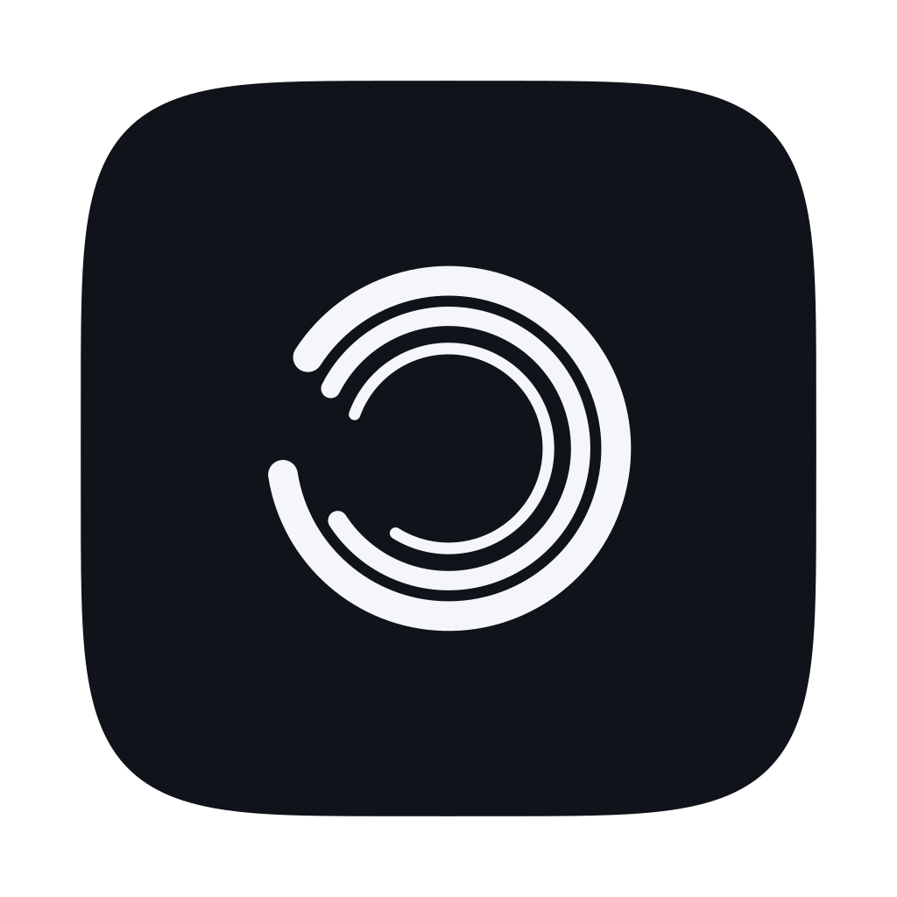
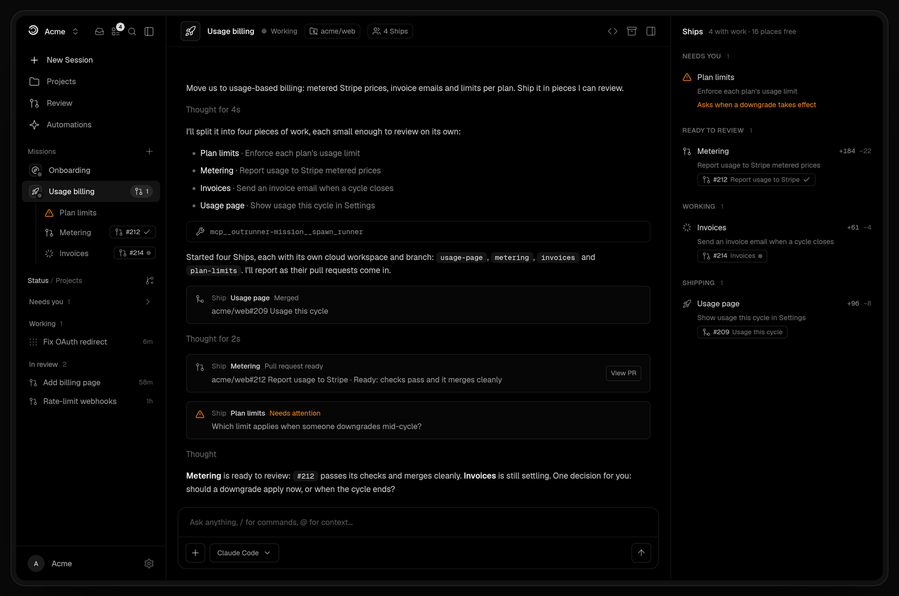
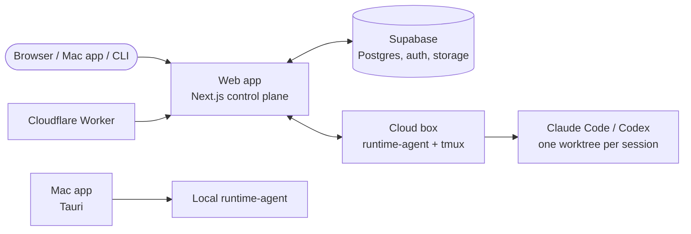

<div align="center">



### Outrunner

Run fleets of Claude Code and Codex sessions in the cloud. Hand off a task, get back a pull request.

[**Download for macOS**](https://downloads.outrunner.sh/outrunner/Outrunner.dmg) &nbsp;&bull;&nbsp; [Open the web app](https://app.outrunner.sh) &nbsp;&bull;&nbsp; [Documentation](docs/README.md) &nbsp;&bull;&nbsp; [Changelog](https://github.com/outrunner-sh/outrunner/releases) &nbsp;&bull;&nbsp; [Contributing](CONTRIBUTING.md)

<p align="center">
  
</p>

</div>

## What is Outrunner?

Outrunner is an open-source workspace for running coding agents in parallel,
released under the [MIT License](LICENSE). Each task gets its own cloud
computer, Git worktree, branch, terminal and conversation, so Claude Code or
Codex can work on several tasks in one repository at once, and keep working
after you close the tab.

It is for developers who already hand work to a coding agent and want to run
more than one task at a time, or hand off the whole loop, from issue to
reviewed pull request.

A single agent CLI runs one session in one terminal on your laptop. Outrunner
adds the workspace around the agents:

- **One box per task**: every session runs in its own sandbox, on its own branch and worktree
- **Missions and Ships**: a Mission plans a body of work and delegates each piece to a Ship, its own session with its own pull request
- **Review in the app**: diffs, checks and pull requests next to the conversation, with live previews and the agent's desktop
- **Agent status**: the sidebar shows which session is working, which needs you, and which has a pull request ready
- **Start work from anywhere**: triage, GitHub, GitLab, Slack, Linear, Jira, schedules, the CLI, REST API or MCP server
- **Built for teams**: share repositories, environments, secrets and agent connections across an organization

Outrunner is not a coding agent itself. You connect your own Claude or Codex
subscription, or provider API keys, and Outrunner runs the official agents for
you.

**Platforms**: any modern browser, and a Mac app (universal, Apple Silicon and
Intel) that can also run sessions on your own machine.

## Install

- **Web**: open [app.outrunner.sh](https://app.outrunner.sh) and sign in
- **macOS**: [Outrunner.dmg](https://downloads.outrunner.sh/outrunner/Outrunner.dmg) (universal, signed and notarized) · [All releases](https://github.com/outrunner-sh/outrunner/releases)
- **Terminal**: `npx outrunner@latest` signs you in through your browser and continues onboarding

For another deployment, use `outrunner --url https://your-app.example.com` or
set `OUTRUNNER_URL`. Agent subscriptions, model APIs and cloud compute have
their own accounts, terms and costs.

## Start with one task

1. [Sign in](#install) and connect GitHub (or GitLab) and your coding agent in **Settings**.
2. Pick a repository, choose Claude Code or Codex, and describe a small change.
3. Watch it work, review the diff and the preview, then open the pull request from the session.

## Run tasks in parallel

Every session gets a cloud box with its own worktree, branch, terminal and
conversation. Sessions keep running when you close the browser; the sidebar
groups them by where each stands: **Needs you**, **Working**, **Ready**.

[Sessions](docs/sessions.md) · [Previews](docs/previews.md) · [Agent desktop](docs/desktop.md)

## Delegate with Missions

A **Mission** is a long-lived session that owns one area of a project (billing,
onboarding, the CLI). It plans and delegates instead of writing code: each piece
of work goes to a **Ship**, an ordinary session with its own box and branch.
News from Ships comes back on its own, and the Mission writes to you only when
it needs a decision or a pull request is ready.

[Missions and Ships](docs/missions.md)

## Review and ship

- **Pull requests in the app.** Read the diff, checks and review threads next to the conversation, and send feedback back to the agent.
- **Evidence in every PR.** For a change you can see, the agent runs the app, captures before and after screenshots on its desktop, and puts them in the pull request. [PR evidence](docs/pr-evidence.md)
- **Live previews.** Share a stable link to a dev server running on a session's box, for your org or for anyone. [Previews](docs/previews.md)

## Start work from anywhere

Turn issues, messages and events into sessions without opening the app.

[Triage](docs/sessions.md#triage) · [GitHub](docs/github-app.md) · [GitLab](docs/gitlab.md) · [Slack](docs/slack-app.md) · [Linear](docs/linear-app.md) · [Jira](docs/jira-app.md)

- **Automations**: run a prompt on a schedule or when a pull request opens, across one repository or all of them
- **Mentions**: ask Outrunner on a GitHub issue or pull request, or in a Slack thread
- **Triage**: a queue of work items from the app, Slack, Linear, Jira or the CLI, each one a session away

## Supported agents

Keep your existing agent subscriptions.

| Agent | Runs on |
|:------|:-------|
| [Claude Code](https://github.com/anthropics/claude-code) | A Claude subscription, or an API key from Anthropic, OpenAI, OpenRouter, Z.ai, Moonshot or DeepSeek |
| [OpenAI Codex CLI](https://github.com/openai/codex) | A ChatGPT subscription |

Admins can share a Claude or Codex subscription with their organization, and
the hosted service includes Outrunner's own models for both agents.

## More than a web app

Every surface talks to the same sessions, so you can start a task in one place
and check on it from another.

| Surface | What you get |
|:--------|:-------------|
| [**Web app**](https://app.outrunner.sh) | Sessions, Missions, review, triage, automations and settings |
| [**Mac app**](runtime-desktop/README.md) | A native shell around the web app, with local sessions on your own machine |
| [**CLI**](docs/api.md#cli) | `outrunner create`, `send`, `wait` and `read` from any shell or CI job |
| [**REST API**](docs/api.md) | Start, message, wait on and archive sessions over HTTP |
| [**MCP server**](docs/api.md#mcp) | Let Claude Code, Codex and other agents start and manage sessions themselves |

```sh
claude mcp add --transport http outrunner https://app.outrunner.sh/api/mcp \
  --header "Authorization: Bearer $OUTRUNNER_API_KEY"
```

## Development

Want to hack on Outrunner or contribute a PR? You need Node.js 22.18+, pnpm
10.26.0, Git, and your own [Supabase](https://supabase.com) project:

```sh
git clone https://github.com/outrunner-sh/outrunner.git
cd outrunner
corepack enable
pnpm install --frozen-lockfile
cp .env.example .env.local   # then add your Supabase keys
pnpm dev                     # http://localhost:3000
```

Unit tests and the browser fixtures run without any credentials:

```sh
pnpm check          # typecheck, lint and tests
pnpm test:browser   # isolated browser fixtures
```

See the [**development guide**](docs/development.md) for configuration, cloud
sessions, tests and troubleshooting, and the [**Supabase guide**](supabase/README.md)
for migrations and sign-in.

## Architecture



| Component | Path | Docs |
|:----------|:-----|:-----|
| Web app and API: sign-in, permissions, credentials, session lifecycle | [`app/`](app/), [`components/`](components/), [`lib/`](lib/) | [Development](docs/development.md) |
| Runtime agent: tmux sessions, worktrees, terminals and conversation streams on each box | [`runtime-agent/`](runtime-agent/) | [Runtime agent](docs/architecture/runtime-agent.md) |
| Mac app: native shell and local sessions | [`runtime-desktop/`](runtime-desktop/) | [Desktop](runtime-desktop/README.md) |
| Database: migrations, RLS and auth setup | [`supabase/`](supabase/) | [Supabase](supabase/README.md) |
| Hosting: Cloudflare Containers deployment and the cloud box image | [`cloudflare/`](cloudflare/), [`box/`](box/) | [Cloudflare](docs/deploy-cloudflare.md) |

Cloud sessions run on Daytona, Neev, Modal, or your own Google Cloud project.
The full map is in the [development guide](docs/development.md#repository-map).

## Self-hosting

Outrunner runs on infrastructure you control: deploy the control plane to
[Cloudflare Containers](docs/deploy-cloudflare.md), [Railway](docs/deploy-railway.md),
or [a VM with Docker Compose](docs/deploy-vm.md). The checked-in Cloudflare
config describes the hosted deployment; replace its account, domains and public
Supabase values with your own.

## Contributing

We welcome contributions! See [CONTRIBUTING.md](CONTRIBUTING.md) for how to get
set up and open a PR, and follow the [Code of Conduct](CODE_OF_CONDUCT.md). Bugs
and feature requests go in [issues](https://github.com/outrunner-sh/outrunner/issues).

[](https://github.com/outrunner-sh/outrunner/actions/workflows/ci.yml)
[](https://github.com/outrunner-sh/outrunner/releases)
[](https://github.com/outrunner-sh/outrunner/stargazers)
[](LICENSE)

## Security

Please report vulnerabilities privately, as described in [SECURITY.md](SECURITY.md),
not in public issues.

## License

Outrunner's original source code is copyright (c) 2026 Outrunner, Inc. and
available under the [MIT License](LICENSE): use it, modify it, self-host it and
redistribute it. Third-party dependencies and bundled assets keep their own
licenses; see [THIRD_PARTY_NOTICES.md](THIRD_PARTY_NOTICES.md). The MIT license
does not provide hosted infrastructure, third-party accounts, or rights to
third-party trademarks.
